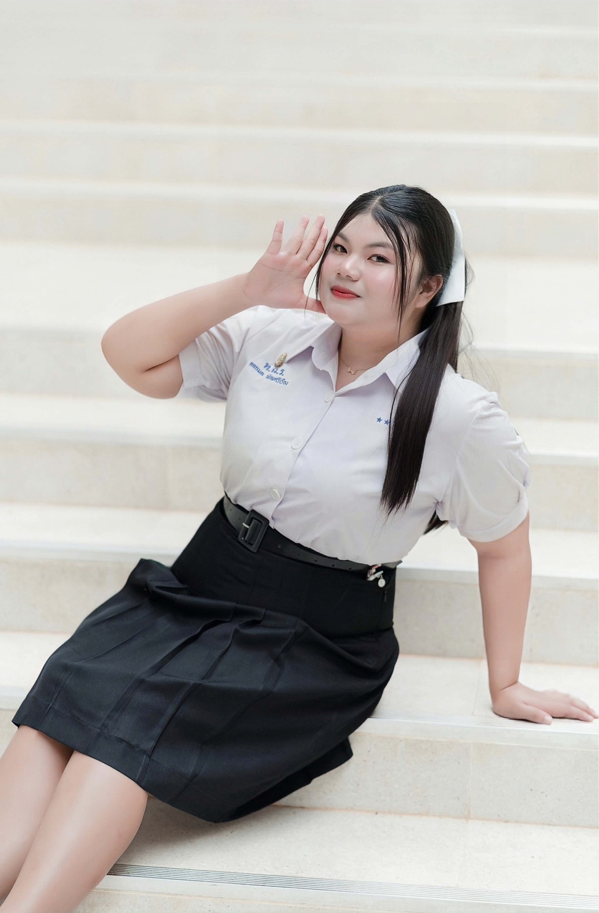
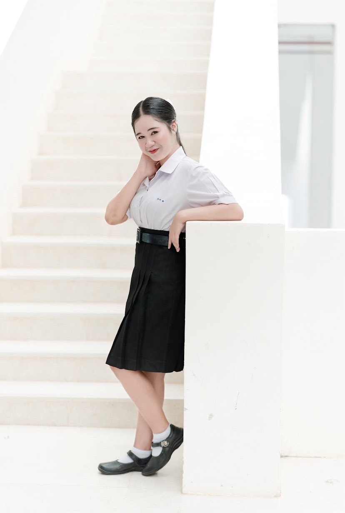

<!DOCTYPE html>

<html lang="th">

<head>

<meta charset="UTF-8">

<meta name="viewport" content="width=device-width, initial-scale=1">

<title>Portfolio | Donkamon & Sirivimon</title>

</head>

<body>

<header>

<h1>PORTFOLIO</h1>

<h2>แฟ้มสะสมผลงานเพื่อเข้าศึกษาต่อ</h2>

คณะศึกษาศาสตร์ วิชาเอกการประถมศึกษา

Donkamon & Sirivimon

</header>

<nav>

<a href="#home">หน้าหลัก</a>

<a href="#profile">ประวัติส่วนตัว</a> 

<a href="#education">ประวัติการศึกษา</a>

<a href="#activity">กิจกรรมและผลงาน</a>

<a href="#skill">ความสามารถ</a>

<a href="#goal">เป้าหมาย</a>

</nav>

<section id="home">

<h2 class="title">ยินดีต้อนรับสู่ Portfolio</h2>

แฟ้มสะสมผลงานเล่มนี้จัดทำขึ้นเพื่อรวบรวมประวัติส่วนตัว ประวัติการศึกษา กิจกรรม ผลงาน และความสามารถ เพื่อประกอบการพิจารณาเข้าศึกษาต่อคณะศึกษาศาสตร์ วิชาเอกการประถมศึกษา

</section>

<section id="profile">

<h2 class="title">ประวัติส่วนตัว</h2>

<h3>คนที่ 1</h3>

<b>ชื่อ:</b> Donkamon Patsriruang

<b>เลขที่:</b> 7

<b>โรงเรียน:</b> ทุ่งใหญ่เฉลิมราชอนุสรณ์รัชมังคลาภิเษก

<b>ระดับการศึกษา:</b> มัธยมศึกษาปีที่ 6

<b>ความสนใจ:</b> ด้านการเป็นคุณครู

<h3>คนที่ 2</h3>

<b>ชื่อ:</b> Sirivimon Kamunee

<b>เลขที่:</b> 19

<b>โรงเรียน:</b> ทุ่งใหญ่เฉลิมราชอนุสรณ์รัชมังคลาภิเษก

<b>ระดับการศึกษา:</b> มัธยมศึกษาปีที่ 6

<b>ความสนใจ:</b> ด้านการเป็นคุณครู

</section>

<section id="education">

<h2 class="title">ประวัติการศึกษา</h2>

<h3>ระดับมัธยมศึกษาตอนปลาย</h3>

โรงเรียนทุ่งใหญ่เฉลิมราชอนุสรณ์รัชมังคลาภิเษก

แผนการเรียน วิทย์-คณิต

เกรดเฉลี่ย 3.30

<h3>ระดับมัธยมศึกษาตอนต้น</h3>

โรงเรียนทุ่งใหญ่เฉลิมราชอนุสรณ์รัชมังคลาภิเษก

แผนการเรียน วิทย์-คณิต

เกรดเฉลี่ย 3.25

</section>

<section id="activity">

<h2 class="title">กิจกรรมและผลงาน</h2>

<h3>1. ฝึกประสบการณ์ที่โรงเรียนบ้านวังตลับ</h3>

ได้ไปสังเกตการสอนและฝึกประสบการณ์ทดลองสอนเด็ก ได้เรียนรู้เกี่ยวกับการสอน การดูแลเด็ก และการอยู่ร่วมกันกับเด็ก

<h3>2. การประกวดหนังสั้น</h3>

เข้าร่วมการประกวดหนังสั้นภายใต้แนวคิด เด็ก To BE วิธีปฏิเสธยา

<h3>3. กิจกรรมจิตอาสาปลูกป่าชายเลน</h3>

เข้าร่วมกิจกรรมเพื่ออนุรักษ์ทรัพยากรธรรมชาติและสิ่งแวดล้อม พร้อมปลูกฝังจิตสำนึกด้านการอนุรักษ์

<h3>4. กีฬาสีภายในโรงเรียน</h3>

ได้รับการคัดเลือกเป็นประธานสีน้ำเงิน ในการแข่งขันนาคาวรรจันทร์วารีหว้าหินเกมส์

</section>

<section id="skill">

<h2 class="title">ความสามารถและทักษะ</h2>

<ul>

<li>มีความอดทน</li>

<li>สามารถทำงานเป็นทีม</li>

<li>มีภาวะความเป็นผู้นำ</li>

<li>มีความรับผิดชอบต่อตนเองและผู้อื่น</li>

</ul>

<h3>งานอดิเรก</h3>

ดูข่าวสารและฟังเพลง

<h3>คติประจำใจ</h3>

เป้าหมายใหญ่ ต้องใจแข็ง

</section>

<section id="goal">

<h2 class="title">MY GOAL</h2>

มุ่งมั่นที่จะศึกษาเพื่อเข้ารับราชการและเป็นผู้บริหาร ยึดมั่นในความถูกต้องและการทำงานที่ดี พร้อมพัฒนาตนเองเพื่อเป็นครูที่มีคุณภาพและเป็นแบบอย่างที่ดีให้แก่นักเรียน

</section>

<footer>

<h3>PORTFOLIO</h3>

Donkamon Patsriruang No.7

Sirivimon Kamunee No.19

คณะศึกษาศาสตร์ วิชาเอกการประถมศึกษา

</footer>
<section class="students">
  <h2>ประวัตินักเรียน</h2>

  

    
    <h3>Donkamon Patsriruang</h3>
  

  

    
    <h3>Sirivimon Kamunee</h3>
  

</section>

</body>

</html
